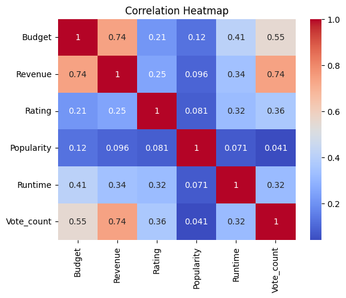
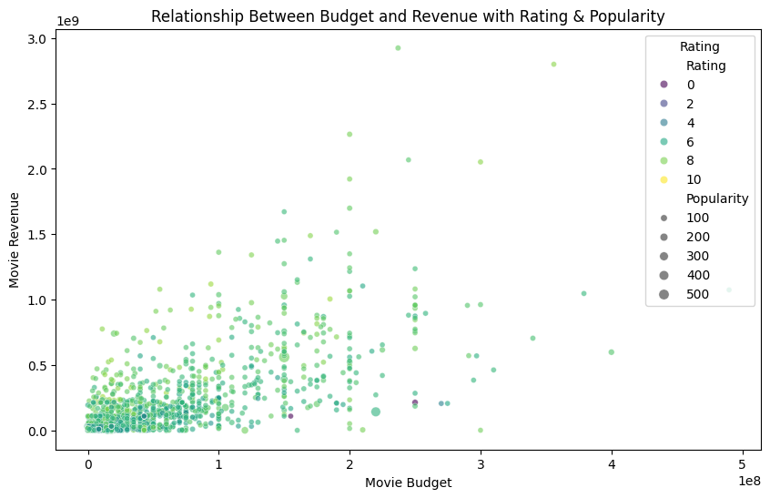

# TMDB Movie Success Analysis and Prediction

An end-to-end data science project that collects, cleans, analyzes, and models a dataset of 5,000 popular movies from The Movie Database (TMDB) API. The goal is to uncover insights into what drives a movie's financial success and to build a predictive model for estimating profit and audience ratings.

## Demo

*Exploratory Data Analysis - Correlation Heatmap*


*Budget vs. Revenue Analysis*


*Genre Word Cloud*


## Features

- **Complete Data Science Lifecycle:** Follows a structured workflow from data acquisition and cleaning to exploratory analysis and predictive modeling.
- **API Data Collection:** Programmatically fetches movie data from the TMDB API, handling pagination and rate limiting.
- **Robust Data Cleaning:** Handles duplicates, null values, invalid data, and zero-value placeholders with documented, reproducible steps.
- **In-Depth EDA:** Provides numerous visualizations including correlation heatmaps, scatter plots, bar charts, box plots, and word clouds.
- **Predictive Modeling:** Trains and evaluates Linear Regression and Random Forest models to predict movie profit and rating, with a reusable prediction function.

## Tech Stack

- **Language:** Python 3.12+
- **Libraries:**
  - `pandas`: Data manipulation and analysis
  - `numpy`: Numerical operations
  - `matplotlib`: Base plotting library
  - `seaborn`: Statistical data visualization
  - `scikit-learn`: Machine learning models and preprocessing
  - `requests`: API calls to TMDB
  - `wordcloud`: Generating the genre word cloud
  - `matplotlib-venn`: Venn diagrams for comparison plots
- **Algorithms:** Linear Regression, Random Forest Regression
- **Data Source:** [The Movie Database (TMDB) API](https://www.themoviedb.org/documentation/api)

## Getting Started

### Prerequisites
- Python 3.10 or higher.
- A TMDB API key (for data collection only; the raw data is already included in this repo).

### Installation

Clone the repository:
   ```bash
   git clone https://github.com/YourUsername/tmdb-movie-success-analysis.git
